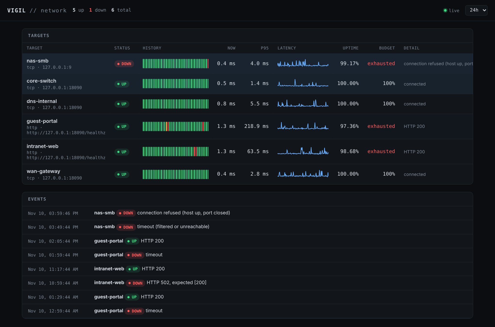

# Vigil

[](https://github.com/Jamie-233/vigil/actions/workflows/ci.yml)
[](LICENSE)
[](pyproject.toml)
[](https://github.com/Jamie-233/vigil/stargazers)

**Self-hosted network monitoring in a single process.** Async ICMP, TCP, HTTP and DNS probes; flap-resistant alerting; SLO and error-budget tracking; Prometheus metrics; and a live dashboard — no database server, no agents, no root.



```
            ┌──────────────── vigil (one asyncio process) ────────────────┐
targets ──▶ │ scheduler ─▶ probes ─▶ state machine ─▶ notifier ─▶ webhooks │
 (YAML)     │                 │            │                               │
            │                 ▼            ▼                               │
            │            SQLite (WAL) ◀── events                           │
            │                 │                                            │
            │     /api  /api/stream (SSE)  /metrics  dashboard             │
            └──────────────────────────────────────────────────────────────┘
```

## Why

Ping-based monitors answer one question — *is it routed?* — and alert on every lost packet. Real outages are more varied (the port is open but the app returns 500; the record resolves but to the wrong address; the certificate expires on Monday), and alerts that fire on noise get muted, which is worse than no monitoring at all. Vigil checks each layer separately and only changes state when the evidence is consistent.

## Why not...

- **...Prometheus with the Blackbox Exporter?** That is the standard answer, and if you already run Prometheus, Alertmanager and Grafana it is the better one. Vigil is for the case where you want one process, no database server and no extra services, with hysteresis, flap detection and SLO tracking built in. It also serves `/metrics`, so it can feed a Prometheus later.
- **...Zabbix or a hosted status service?** Those cover far more (agents, SNMP, templates, user management, hosted probes from several regions). Vigil probes from a single vantage point and does not try to be a platform.
- **...asking an LLM?** A model cannot produce availability or latency data; it can only interpret data something else measured. Vigil is that measurement layer.

## Features

| | |
|---|---|
| **Four probe layers** | ICMP (loss, jitter), TCP (refused vs. filtered), HTTP (status, body, TLS expiry), DNS (record assertions against a chosen resolver) |
| **Hysteresis** | `fail_after` / `recover_after` thresholds per target, like a Schmitt trigger, so a target hovering at the edge can't oscillate |
| **Flap detection** | repeated transitions inside a window are flagged separately from "down" |
| **SLOs** | availability, p50/p95/p99 latency, latency-SLO compliance and remaining error budget per time range |
| **Alerting** | Slack, Discord or raw JSON webhooks; queue-isolated from probing; exponential backoff; honours `Retry-After` |
| **Prometheus** | `/metrics` with counters for success/failure, debounced `up`, latency, flapping and certificate expiry |
| **Dashboard** | live over Server-Sent Events, status-page history bars, latency sparklines, down targets sorted first |
| **Editable from the dashboard** | add, edit and remove targets in the browser; changes are validated, written back to the YAML atomically and applied without a restart. Only accepted from the local machine |
| **Smoke tests** | `vigil check` probes everything once and exits non-zero on failure — a post-change verification step |

## Quick start

```bash
pip install -e .
cp examples/vigil.yml vigil.yml   # edit targets
vigil check -c vigil.yml          # one-shot sweep
vigil run   -c vigil.yml          # daemon + dashboard on http://127.0.0.1:8080
```

ICMP runs unprivileged. On Linux, allow it once for the user running Vigil:

```bash
sudo sysctl -w net.ipv4.ping_group_range="0 2147483647"
```

## Configuration

```yaml
defaults:
  interval: 30
  timeout: 5
  fail_after: 3
  recover_after: 2

webhooks:
  - url: https://hooks.slack.com/services/...
    format: slack

targets:
  - name: wan-gateway
    type: icmp
    address: 192.168.1.1
    interval: 10
    fail_after: 2
    latency_slo_ms: 5

  - name: website
    type: http
    address: https://example.com/
    availability_slo: 99.5
    options: { expect_status: [200], expect_body: "Example Domain", cert_warn_days: 21 }

  - name: intranet-dns
    type: dns
    address: files.corp.lan
    options: { server: 10.10.0.53, record: A, expect: ["10.10.0.20"] }
```

## API

| Endpoint | |
|---|---|
| `GET /api/targets?range=24h` | current health and SLO summary per target (`1h`, `6h`, `24h`, `7d`, `30d`) |
| `GET /api/targets/{name}/series?range=24h` | downsampled history (max latency per bucket) |
| `GET /api/events?range=7d` | state transitions |
| `GET /api/stream` | live probe results as Server-Sent Events |
| `GET /metrics` | Prometheus exposition |
| `POST /api/targets`, `PUT` / `DELETE /api/targets/{name}` | edit targets; loopback only, needs the `X-Vigil: 1` header |

## Design notes

- **Fixed-rate, not fixed-delay, scheduling.** The next run is anchored to when the previous one was due. Sleeping *after* each probe drifts by the probe's own latency, so a degraded network would quietly be sampled less often — undercounting failures exactly when they happen. Start times are randomised across the interval so targets don't fire in a burst and measure the monitor's own traffic.
- **Percentiles, not averages.** A link answering in 2 ms 95% of the time and 800 ms otherwise averages ~42 ms — a latency nobody experiences. Downsampling keeps the *max* per bucket so short spikes survive on long ranges.
- **Failures count against the latency SLO.** Otherwise a service that times out looks perfectly fast.
- **Alert delivery is decoupled.** Webhooks run on their own bounded queue; a dead chat endpoint can never stall probing.
- **SQLite in WAL mode.** A few writes per second is nothing for SQLite, and WAL lets the dashboard read while probes write, so slow queries can't create gaps in the data.
- **SSE over WebSockets.** One-way data, automatic reconnect, and it survives corporate proxies that break WebSocket upgrades.

## What has been verified

| Area | How | Not yet |
|---|---|---|
| State machine: hysteresis, flap detection, percentiles, error budget, failures counting against the latency SLO | unit tests | - |
| TCP (open versus refused), HTTP (status, body, timeout) probes | tests against local servers | - |
| ICMP and DNS probes | - | **no automated test** |
| Scheduler, SQLite store, downsampling, Prometheus output, API, SSE | tests | - |
| Webhook retry and rate-limit handling | test against a fake endpoint | not against Slack or Discord |
| Behaviour under load: number of targets, CPU and memory, scheduling lag | - | **not measured**, so the "single process" claim has no numbers yet |

## Development

```bash
pip install -e '.[dev]'
pytest
```

## License

MIT
